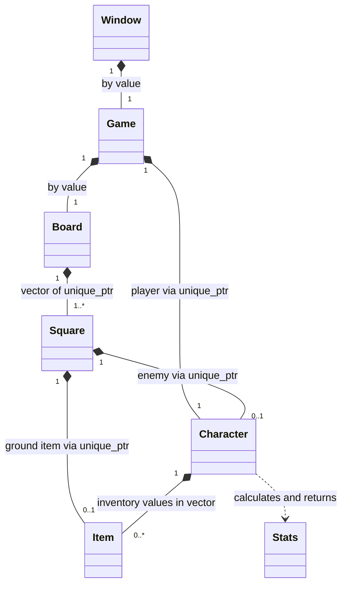
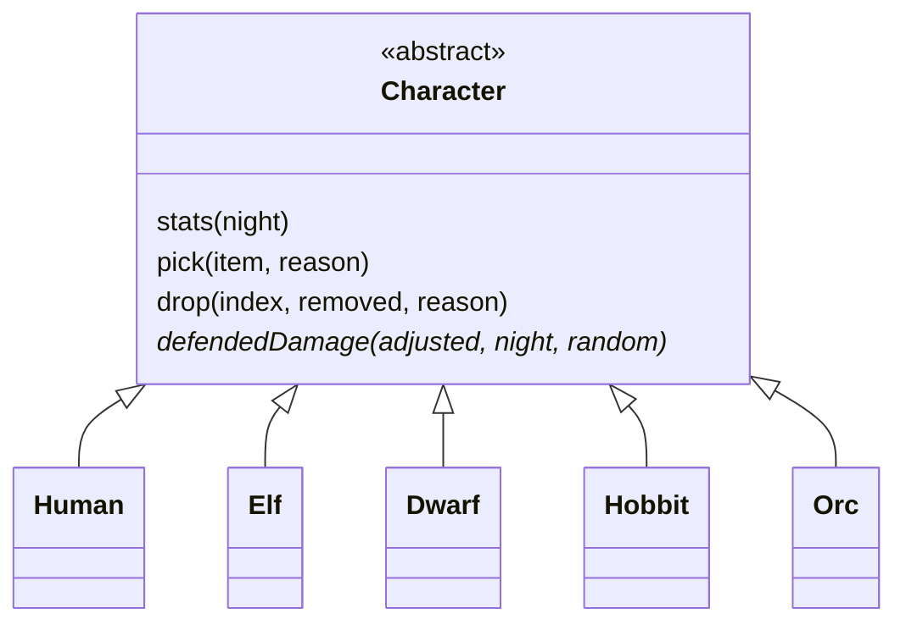

# assignment2_final

A C++17 / Qt Widgets fantasy game for EE6161 Assignment 2, organised for learning and source-code explanation.

This edition uses classes, constructors, inheritance, pure virtual methods, vectors, unique pointers, loops, if/switch statements, random-number generation, and named Qt slots. It does not declare any `struct` types and does not use lambdas in the application code.


Start with [START_HERE.md](START_HERE.md), the Chinese architecture and code-reading guide.

## Build in Qt Creator

1. In Qt Creator, choose **File > Open File or Project** and open [`CMakeLists.txt`](CMakeLists.txt).
2. Select an installed **Desktop Qt kit** for your operating system.
3. Click **Configure Project**, then **Build**.
4. Select **assignment2_final** as the run target and press **Run**.

CMake is the only build system in this repository. `CMakeLists.txt` lists the source files, Qt libraries and targets. Qt Creator runs CMake for you; command-line commands are optional.

| Target | Purpose |
| --- | --- |
| `assignment2_final` | The game application to run |
| `game_core` | The C++ game library used by the application and tests |
| `basic_tests` | A separate console program that checks game rules |

C++17 and Qt Widgets are required. No other runtime libraries are used. CMake's `AUTOMOC` setting processes `Q_OBJECT` for the named Qt slots automatically.

## Command-line build and tests

```sh
cmake -S . -B build -DCMAKE_PREFIX_PATH="/path/to/your/Qt/kit"
cmake --build build
ctest --test-dir build --output-on-failure
```

On macOS, the application is `build/assignment2_final.app`. On Windows, use the matching MSVC or MinGW Qt kit; Qt Creator provides the simplest build/run route. To build only the application, configure with `-DBUILD_TESTING=OFF`.

## Controls

Set Width, Height and Race, then click New game. Type commands and press Enter/Send, or use the buttons:

| Command | Action |
| --- | --- |
| n / s / e / w | Move north / south / east / west |
| p | Pick up current item |
| d | Choose an item to drop |
| a | Attack current enemy |
| l | Look at current location |
| i | Display inventory and gold |
| x or exit | End the game and show gold |

Input is case-insensitive. HP is health, A is attack, D is defence, Load is weight/capacity and Gold is the score. Defeating enemies earns gold; HP at or below zero ends the game. The GUI intentionally uses location text rather than a full-board map.

Every submitted command advances time, including unsuccessful or empty commands and cancelling a drop. Each day/night phase lasts five commands. A surviving enemy immediately counterattacks after an attack, including a missed player attack. Enemies do not chase.

## Modules

| Files | Responsibility |
| --- | --- |
| main.cpp | Create QApplication and show Window |
| window.h/.cpp | Basic GUI, named button slots and text input |
| game.h/.cpp | Dispatch commands to small action functions and update turns |
| board.h/.cpp | Allocate and find map squares |
| square.h | One location owning optional contents |
| character.h/.cpp | Abstract role, attributes, inventory and capacity checks |
| races.h/.cpp | Human, Elf, Dwarf, Hobbit, Orc and a simple creation switch |
| item.h/.cpp | Item class, constructor and equipment catalogue |
| stats.h | Stats class holding calculated attributes |
| race.h/.cpp | Race enumeration and display names |
| tests/basic_tests.cpp | Separate core test program |

## Documented rule choices

- Formal race-table values take precedence over inconsistent combat examples.
- East is e; exit is x or the full word exit.
- Damage cannot be negative; successful defence can explicitly heal. Orc daytime defence damage is divided by four, rounded down.
- Carried equipment applies automatically. Rings can repeat without a fixed slot limit. Health modifiers apply immediately, and healing has no specified maximum.
- Dropping a strength ring is refused if the remaining inventory would be overweight. Removing a life ring or collecting a strength ring can cause defeat.
- Initial contents are exclusive: enemy, item or empty. Drops onto enemies or existing items are refused. Non-start squares use 35% enemy, 35% item and 30% empty probability. Some enemies carry one random item; enemy equipment disappears on defeat, while its defence modifier affects gold.
- The start is empty. Board dimensions are selectable from 1 to 100 each as a practical allocation guard; this is a documented implementation limit rather than a fixed board size specified by the assignment.
- Zero-damage encounters and defence healing can cause stalemates; movement away remains available. There is no automatic victory when enemies are exhausted.

## Submission documents and validation

- `CLASS_DESIGN_REPORT.txt`: English class-design report in the project root.
- `REQUIREMENTS.md`: Assignment requirement mapping and remaining verification.
- `BASIC_TESTS.md`: Automated and manual checks.
- `VALIDATION.txt`: Actual results and limitations.

macOS builds and tests do not verify the assignment's mandatory Windows Qt Creator build. That step remains necessary before claiming full platform compliance. The repository contains this edition; the previous version remains available in Git history.


## Object ownership

The solid diamond indicates ownership. Multiplicities describe a running game.



Square contents are mutually exclusive: an enemy, an item, or neither. The inventory grows dynamically; it has no fixed item-count limit. `Stats` is a calculation result returned by value. `Item`, `Stats` and `Square` are all declared as classes in this edition.

## Character inheritance

Each of the five races directly inherits the abstract `Character` class. Human and Dwarf have separate classes, even though their successful-defence rules are identical, so the code maps directly to the assignment's race table.



`makeCharacter(Race)` uses a switch to construct a concrete character and return it through `unique_ptr<Character>`. `Game::strike()` calls the virtual `defendedDamage()` method; the actual race selects the implementation. A virtual base destructor ensures correct cleanup.

## Follow one command

```text
Attack button
  -> Window::onAttackClicked()
  -> Window::submit("a")
  -> Game::command()
  -> Game::attackEnemy()
  -> Game::strike(player, enemy)
     -> stats(), random rolls, virtual defendedDamage(), damage()
  -> remove defeated enemy and award gold, or strike(enemy, player)
  -> check player defeat and advanceTime() once
  -> return result text
  -> Window displays the text and calls refresh()
```

`movePlayer()`, `pickUpItem()`, `dropItem()` and `attackEnemy()` each handle one action. Named Qt slots make each button's call path explicit. [START_HERE.md](START_HERE.md) explains startup, ownership, the reading order and the callers/results of the main functions in Chinese.
