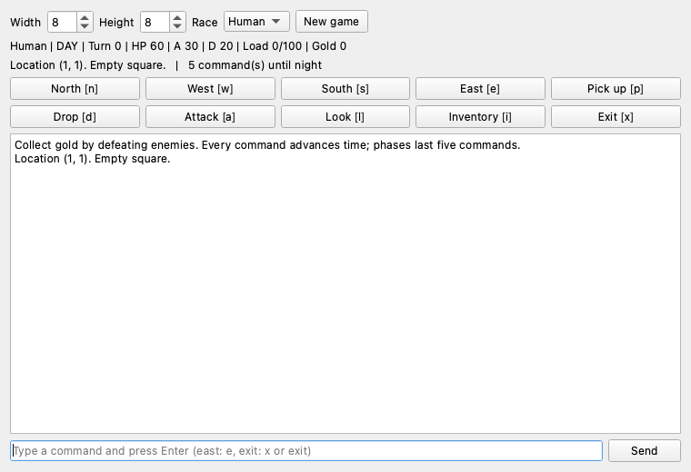
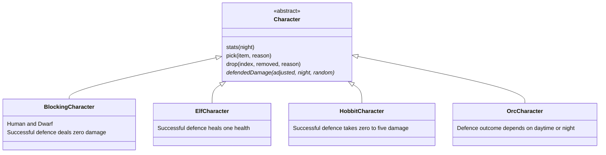

# Fantasy Game

A simple C++17 fantasy game with a Qt Widgets interface, developed for **EE6161 Advanced Programming, Assignment 2**. Explore a rectangular board, collect equipment, fight enemies and earn as much gold as possible before ending the game or being defeated.



## Features

- Five races: Human, Elf, Dwarf, Hobbit and Orc.
- Eight equipment types, carrying-weight limits and stackable rings.
- Probability-based attacks and defences with race-specific defence abilities.
- Alternating daytime and night-time every five commands.
- A dynamic rectangular board with individually allocated squares.
- A basic GUI with keyboard input, action buttons, an event log and item-selection dialogs.
- A standard C++ core that can be tested independently of the GUI.

## Requirements

- A C++17 compiler.
- Qt Widgets; the build files accept Qt 5 or Qt 6. This project has been tested with **Qt 6.11.2 on Apple Silicon macOS**.
- Qt Creator, or CMake 3.16+ with a supported build tool.
- Qt Test is optional and enables the GUI interaction tests.

The game uses only standard C++ and Qt libraries. Doxygen and clang-format are optional development tools.

## Build and run

### Qt Creator

1. Clone or download this repository.
2. Open `CMakeLists.txt` using **File > Open File or Project**.
3. Select an installed **Desktop Qt kit** for your operating system.
4. Configure and build the project.
5. Select **FantasyGame** as the run target and press **Run**.

The project also includes `FantasyGame.pro` for qmake. Use a separate build directory for each build system.

| Target | Purpose |
| --- | --- |
| `FantasyGame` | The application to run |
| `game_core` | The standard C++ game library |
| `core_tests` | Core rules and regression tests |
| `gui_tests` | GUI interaction tests, available when Qt Test is installed |

### CMake on macOS

```sh
git clone https://github.com/Eleanorecheng/fantasyGame.git
cd fantasyGame
cmake -S . -B build -DCMAKE_PREFIX_PATH="$HOME/Qt/6.11.2/macos"
cmake --build build
ctest --test-dir build --output-on-failure
open build/FantasyGame.app
```

Adjust the Qt path to match your installation. If CMake is not on your `PATH`, use Qt Creator or the CMake executable bundled with Qt. Add `-DBUILD_TESTING=OFF` when configuring to build only the game.

### Windows

Open the project in Qt Creator and choose a Windows desktop kit. Use an MSVC or MinGW compiler that matches the installed Qt libraries, then configure, build and run **FantasyGame**.

**Windows compilation has not yet been verified.** The assignment requires a successful Windows Qt Creator build; the macOS results do not establish that requirement.

## How to play

Choose **Width**, **Height** and **Race**, then click **New game**. The default game starts as a Human on an 8 x 8 board at location `(1, 1)` during daytime. Setup changes take effect when a new game starts; starting a new game clears the current progress.

Click an action button, or type a command and press **Enter** or **Send**. Commands are case-insensitive.

| Command | Action |
| --- | --- |
| `n`, `s`, `e`, `w` | Move north, south, east or west |
| `p` | Pick up the item at the current location |
| `d` | Choose an inventory item to drop |
| `a` | Attack the enemy at the current location |
| `l` | Describe the current location |
| `i` | List carried items and earned gold |
| `x` or `exit` | End the game and display the final gold total |

**HP** is current health, **A** is attack, **D** is defence, **Load** is carried weight / carrying capacity, and **Gold** is the current score. The location line describes enemies and items; there is no full-board map in this basic interface.

Every submitted command advances time, including failed actions, look/inventory, empty or unknown commands, and cancelling a drop. The first five commands resolve during daytime; the following five resolve at night. Orcs are stronger at night.

An enemy counterattacks immediately after a player's attack unless it has been defeated. Defeating it awards gold equal to its effective defence. Health at or below zero ends the game. Moving away from an enemy is allowed; enemies do not chase.

## Source structure

| Module | Responsibility |
| --- | --- |
| `main.cpp` | Creates the application and starts the Qt event loop |
| `window.h/.cpp` | Builds the GUI, accepts input and displays results |
| `game.h/.cpp` | Coordinates commands, combat, turns, gold and game-over state |
| `board.h/.cpp` | Allocates the rectangular board and checks coordinates |
| `square.h` | Represents one location with optional contents |
| `character.h/.cpp` | Defines the abstract character and shared attribute/inventory rules |
| `races.h/.cpp` | Implements concrete defence behaviours and the character factory |
| `item.h/.cpp` | Defines equipment categories and the eight-item catalogue |
| `race.h/.cpp` | Defines race identifiers and display names |
| `stats.h` | Holds computed attributes and probabilities |
| `tests/` | Exercises the core rules and public GUI controls |

## Object ownership

A solid diamond in the following diagram means that one object owns another and controls its lifetime. Multiplicities describe a running game.


- `Window` owns one `Game`, which owns the board and player.
- `Board` stores `std::vector<std::unique_ptr<Square>>`. Each square is allocated separately using `std::make_unique<Square>()`.
- A square owns either an enemy, an item, or neither. Although both optional pointers appear in the diagram, game rules keep their contents mutually exclusive.
- A character's inventory is `std::vector<Item>`. Items are stored by value and the vector has no fixed slot-count limit; category and carrying-weight rules determine what can be carried.
- `std::unique_ptr` provides exclusive ownership and automatic cleanup. Moving a pointer into a container transfers ownership; it does not copy the pointed-to object.
- `Stats` is calculated and returned by value. It is not a separately owned, persistent stats object.
- Qt child widgets use Qt's parent ownership and are cleaned up with their parent window.

## Character inheritance

The same hierarchy represents both players and enemies. An inheritance arrow points toward the base class.



`Character` is abstract because `defendedDamage(...)` is pure virtual. Its virtual destructor permits safe cleanup through `std::unique_ptr<Character>`.

Human and Dwarf share `BlockingCharacter` because their successful-defence behaviour is identical. Their base attributes remain different and are selected using `Race`.

`makeCharacter(Race)` creates the correct concrete type and returns a `std::unique_ptr<Character>`. During combat, `Game::strike()` calls the defender through a `Character` reference. Virtual dispatch selects the correct defence behaviour without the combat code selecting a concrete class.

### Example: one attack command

```mermaid
sequenceDiagram
    actor Player
    participant Window
    participant Game
    participant Defender as Enemy Character
    Player->>Window: Click Attack or enter a
    Window->>Game: command("a")
    Game->>Game: Roll attack and defence
    opt Attack hits and defence succeeds
        Game->>Defender: defendedDamage(...)
        Defender-->>Game: Race-specific signed damage
    end
    Game->>Game: Apply damage; reward gold or counterattack
    Game->>Game: Check defeat and advance time
    Game-->>Window: Result text
    Window->>Window: Refresh status and location
    Window-->>Player: Display the result
```

## Rule decisions

The assignment leaves some edge cases unspecified and includes example values that differ from its formal table. This implementation uses the following decisions:

- The formal race table takes precedence over combat example numbers.
- East uses `e`; exit uses `x` or the full word `exit` to resolve their shared initial.
- Damage is `max(0, attack - defence)`. Orc daytime successful-defence damage is divided by four and rounded down.
- Equipment modifies current health immediately. Defence healing has no upper cap because no maximum health is specified. Dropping a life ring or picking up a strength ring can cause defeat.
- A strength ring cannot be dropped if the remaining items would exceed the resulting carrying capacity.
- Board dimensions range from 1 to 100 in each direction as a practical allocation guard; board size is not fixed at 8 x 8.
- The start is empty. Other squares independently contain an enemy (35%), an item (35%), or nothing (30%). Some enemies carry one random item.
- Dropping onto an enemy or an existing item is refused. Enemy equipment disappears on defeat, but its defence modifier affects the gold reward.
- There is no automatic victory condition when enemies are exhausted. Exit or defeat ends the game. Zero-damage matchups and defence healing can produce stalemates; the player can move away.

## Validation and documentation

The macOS project has passed CMake and qmake builds without compiler warnings, core regression tests, offscreen GUI interaction tests, Doxygen checks and the configured formatting checks. Native desktop interaction and Windows compilation remain unverified. Full details are in [VALIDATION.txt](VALIDATION.txt).

- [Class design report](CLASS_DESIGN_REPORT.txt)
- [Assignment requirement mapping](REQUIREMENTS.md)
- [Chinese usage guide](使用說明.md)

Run `ctest --test-dir build --output-on-failure` after a CMake build to run the available tests. GUI tests use Qt's offscreen platform and require Qt Test.

Public API comments and pseudocode are included in the source. Run `doxygen Doxyfile` from the repository root to generate HTML documentation in `docs-generated/`. The `.clang-format` configuration records the project's K&R-style formatting choices.
